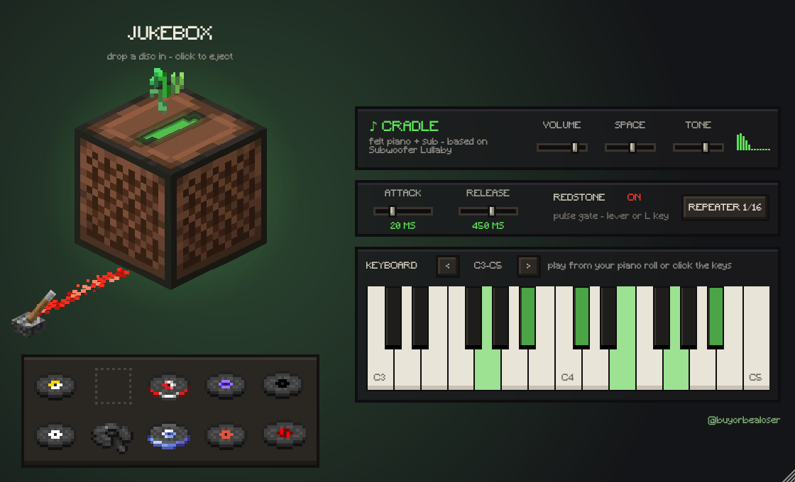

# JUKEBOX

A Minecraft-style instrument plugin (VST3 for Windows and macOS, plus AU on macOS).
Drop one of the 10 coloured discs into the jukebox and play it from your DAW's piano roll.



## The discs

| Disc | Sound |
|---|---|
| ARPEGGIO | soft sustained synth, timbre modelled on C418's *Aria Math* |
| CRADLE | felt piano + sub, timbre modelled on C418's *Subwoofer Lullaby* |
| EMBER | dark saw pad with a sub octave |
| AMETHYST | glass FM bells |
| VOID | slow dark drone |
| SNOW | music box, metal tines |
| CRACKED | broken record: bitcrush, wow & flutter, dropouts |
| LAGOON | watery electric piano, tremolo |
| AMBER | warm analog brass, vibrato |
| SPIRAL | hypnotic swirling supersaw |

ARPEGGIO and CRADLE were tuned against spectral analysis of the reference tracks (attack time, harmonic profile, roll-off, sub energy).
Only the timbres are modelled, not the melodies. All ten discs are level-matched.

## Controls

- **Discs**: click a disc or drag it onto the jukebox. Click the jukebox to eject.
- **VOLUME / SPACE / TONE**: output level, reverb amount, low-pass tone.
- **ATTACK / RELEASE**: envelope applied to every disc. Inserting a disc resets RELEASE to that disc's default.
- **Redstone lever** (click it, or press **L**): turns on a pulse gate that chops the sound in time with the DAW.
  **REPEATER** sets the pulse rate: 1/4, 1/8, 1/16, 1/8T.
- **Keyboard**: click the keys to audition, or press ↑ / ↓ to change octave. Incoming MIDI lights the keys.
- Everything (disc, lever, knobs, octave) is saved with your project, and all knobs can be automated.
- The window is resizable.

## Install

Download the zip for your system from the **Actions** tab (latest successful *Build* run → *Artifacts*) or from **Releases**.

**Windows (FL Studio, Ableton, …)**
1. Unzip `JUKEBOX-Windows-VST3.zip`.
2. Copy `JUKEBOX.vst3` to `C:\Program Files\Common Files\VST3\`.
3. In FL Studio: *Options → Manage plugins → Find installed plugins*, then add **JUKEBOX** as a generator.

**macOS**
1. Unzip, then copy `JUKEBOX.vst3` to `~/Library/Audio/Plug-Ins/VST3/` (and `JUKEBOX.component` to `~/Library/Audio/Plug-Ins/Components/` for Logic).
2. The build is not notarised, so remove the quarantine flag once in Terminal:
   ```
   xattr -cr ~/Library/Audio/Plug-Ins/VST3/JUKEBOX.vst3 ~/Library/Audio/Plug-Ins/Components/JUKEBOX.component
   ```
3. Rescan plugins in your DAW.

## Build from source

Requires CMake 3.22+ and a C++17 compiler (Visual Studio 2022 / Xcode). JUCE 8.0.9 is downloaded automatically.

```
cmake -B build -DCMAKE_BUILD_TYPE=Release
cmake --build build --config Release --target Jukebox_VST3
```

Tests (Linux/macOS): add `-DJUKEBOX_BUILD_TESTS=ON`, then run `JukeboxPluginTest` (MIDI → audio for every disc, redstone gate, state save/restore, editor screenshots), `JukeboxHostTest path/to/JUKEBOX.vst3` (loads the built bundle in a VST3 host) and `JukeboxRenderTest` (renders every disc to WAV and prints levels). CI runs all three on every push.

## Project layout

```
Source/Engine/      DSP: the 10 instruments, Web-Audio-style automation, FX chain (delay, reverb, tone, gate, compressor)
Source/UI/          jukebox scene, lever + redstone, disc shelf, PS1-style voxel notes, pixel look & feel
Source/Plugin*.cpp  JUCE processor / editor
Assets/             textures, discs, font
Tools/              offline tests
preview/            the original browser prototype
```

## Assets

The jukebox and disc textures and the Minecraft font are third-party assets supplied by the project owner.
Check their licences before distributing the plugin commercially.

---
BUY OR BE A LOSER - @buyorbealoser
